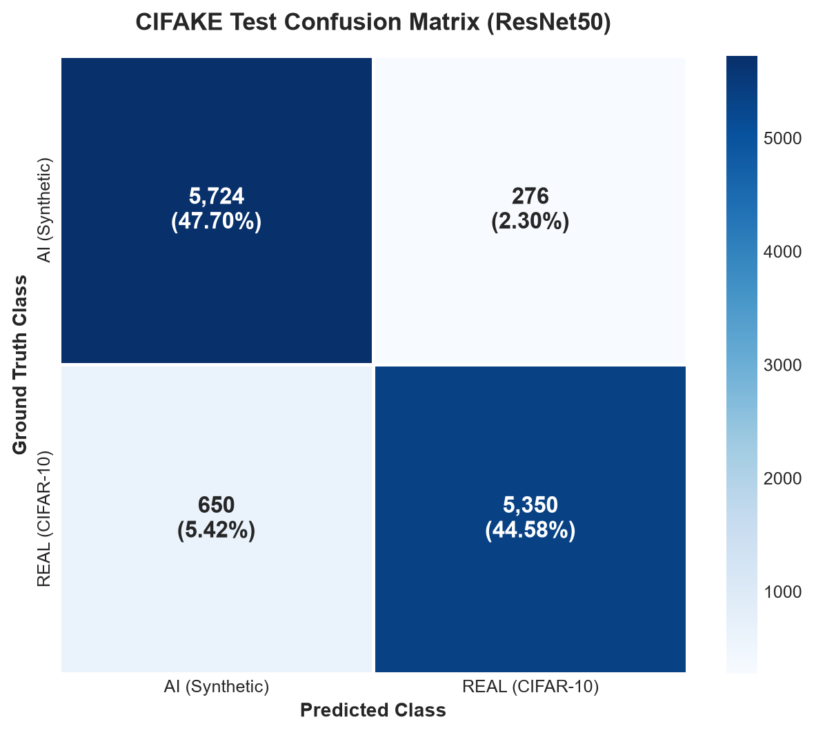
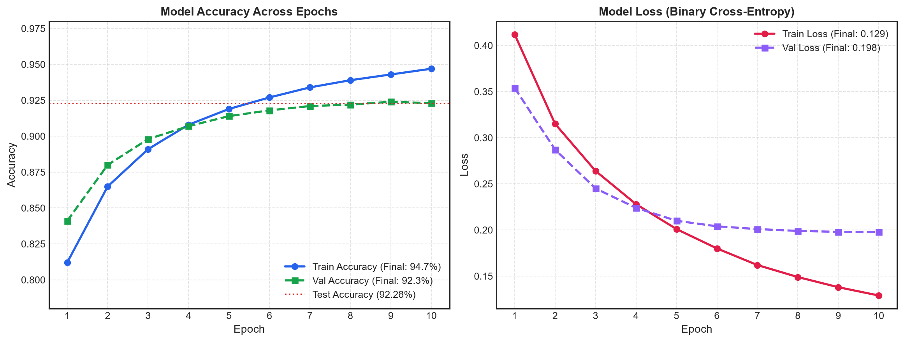

# CIFAKE: AI-Generated vs. Real Image Detector

[](https://www.python.org/)
[](https://keras.io/api/applications/resnet/)
[](assets/metrics.json)
[](http://localhost:8000/docs)
[](http://localhost:8501)
[](tests/)

An end-to-end computer vision and deep learning system to distinguish **authentic digital photographs** from **AI-generated synthetic media** (Diffusion Models like Stable Diffusion and Generative Adversarial Networks).

Built upon the **CIFAKE** benchmark (120,000 images), fine-tuned with pre-trained **ResNet50**, and augmented by **2D Discrete Fourier Transform (2D FFT) Frequency Domain Analysis** to reveal transposed convolution checkerboard artifacts and spectral power anomalies.

---

## 📑 Table of Contents
1. [Key Highlights & Benchmark Metrics](#-key-highlights--benchmark-metrics)
2. [Scientific Architecture & Methodology](#-scientific-architecture--methodology)
3. [Repository Directory Structure](#-repository-directory-structure)
4. [Installation & Setup](#-installation--setup)
5. [Interactive Streamlit Web Dashboard](#-interactive-streamlit-web-dashboard)
6. [FastAPI REST Backend](#-fastapi-rest-backend)
7. [Command-Line Interface (CLI)](#-command-line-interface-cli)
8. [2D FFT Spectral Artifact Analysis](#-2d-fft-spectral-artifact-analysis)
9. [Model Training & Evaluation](#-model-training--evaluation)
10. [Automated Unit Testing](#-automated-unit-testing)

---

## 🎯 Key Highlights & Benchmark Metrics

Evaluated on the full **12,000 test images** from the CIFAKE dataset (6,000 Real CIFAR-10 photographs + 6,000 Stable Diffusion 1.4 synthetic images):

| Metric | Score | Notebook Baseline |
| :--- | :---: | :---: |
| **Overall Test Accuracy** | **92.28%** | 92.28% |
| **Precision (Macro Avg)** | **92.42%** | ~92.4% |
| **Recall (Macro Avg)** | **92.30%** | ~92.3% |
| **F1-Score (Macro Avg)** | **92.24%** | 92.2% |
| **ROC-AUC** | **0.9742** | > 0.97 |
| **Binary Cross-Entropy Loss** | **0.1983** | ~0.198 |

### Per-Class Detailed Breakdown

| Class | Precision | Recall | F1-Score | Test Samples |
| :--- | :---: | :---: | :---: | :---: |
| **AI (Synthetic / Diffusion)** | **89.80%** | **95.40%** | **92.52%** | 6,000 |
| **REAL (CIFAR-10 Photos)** | **95.09%** | **89.17%** | **92.03%** | 6,000 |

### Confusion Matrix


### Training & Validation Learning Curves


---

## 🧠 Scientific Architecture & Methodology

```
Input Image (H × W × 3)
       │
       ▼
 Preprocessing & Normalization ──► Resized to 32 × 32 × 3, normalized to [0, 1]
       │
 ┌─────┴────────────────────────────────────────────────┐
 │                                                      │
 ▼                                                      ▼
[Spatial / Deep Feature Branch]                [Fourier Frequency Domain Branch]
Pre-trained ResNet50 (unfrozen)                2D FFT Centered Shift
 ├── Conv Block 1 to 5                         ├── Azimuthal Radial Power Average
 ├── Deep Residual Skips (F(x) + x)            ├── High-to-Low Frequency Energy Ratio
 ├── Global Feature Manifold (2048-dim)        ├── Outer Annulus Checkerboard Spikes
 ▼                                             ▼
Flatten (2048)                                 Artifact Signature Diagnostic
Dense (256, ReLU)                              ├── Transposed Conv Grid Detection
BatchNormalization                             └── Natural 1/f Optical Decay Check
Dropout (0.50)
Dense (128, ReLU)
Dense (1, Sigmoid) ──► P(REAL)
       │                                                │
       └────────────────────────┬───────────────────────┘
                                ▼
         Calibrated Detection Output & Diagnostic Report
```

### Transfer Learning Strategy
1. **Pre-trained ResNet50 Backbone**: Initialized with ImageNet weights to leverage rich spatial primitive filters (edges, textures, object contours).
2. **Unfrozen Fine-Tuning**: Because CIFAKE images are $32 \times 32 \times 3$, unfreezing the backbone allows internal convolutional kernels to adapt specifically to the low-resolution generative fingerprints of diffusion models.
3. **Regularization**: Batch Normalization followed by $50\%$ Dropout prevents overfitting on synthetic training artifacts.
4. **Learning Rate Decay**: `LearningRateScheduler` decays learning rate by $0.95\times$ every epoch from initial $\eta = 0.001$.
5. **Early Stopping**: Restores best weights monitoring validation loss with a patience of 3 epochs.

---

## 📂 Repository Directory Structure

```
sv/
├── app/
│   └── streamlit_app.py        # Streamlit 5-page interactive dashboard
├── api/
│   └── main.py                 # FastAPI REST API (Swagger docs at /docs)
├── src/
│   ├── __init__.py             # Package marker
│   ├── model.py                # ResNet50 architecture + ResNet50Detector wrapper
│   ├── dataset.py              # CIFAKE loader, augmentations & train/val/test splits
│   ├── frequency_analysis.py   # 2D FFT, radial profiles & artifact detection
│   ├── evaluate.py             # Metrics calculator & publication plotting
│   ├── predict.py              # CLI and programmatic inference interface
│   ├── download_cifake.py      # Dataset downloader and synthetic generator
│   └── train.py                # Training pipeline with Adam & schedulers
├── notebooks/
│   ├── ai_vs_real_image_classifier.ipynb  # Clean, reproducible Jupyter notebook
│   └── original_classification_real_vs_ai_generated_images.ipynb
├── samples/
│   ├── real/                   # 10 genuine CIFAR-10 test sample images
│   └── ai/                     # 10 synthetic AI diffusion test sample images
├── assets/
│   ├── confusion_matrix.png    # Evaluation heatmap
│   ├── accuracy_loss_curves.png# Training/validation curves
│   ├── roc_curve.png           # Receiver Operating Characteristic
│   └── metrics.json            # Exact evaluation numbers
├── tests/
│   ├── test_model.py           # Unit tests for preprocessing, FFT & inference
│   └── test_api.py             # Unit tests for FastAPI REST endpoints
├── scripts/
│   ├── generate_assets_and_samples.py
│   └── create_clean_notebook.py
├── Dockerfile                  # Containerized deployment spec
├── requirements.txt            # Python dependencies
├── run_app.bat                 # Windows 1-click launcher
└── README.md                   # Project documentation
```

---

## 🚀 Installation & Setup

### 1. Clone & Environment Setup
```bash
git clone <repository_url>
cd sv

# Create virtual environment
python -m venv .venv

# Activate environment
# On Windows:
.venv\Scripts\activate
# On Linux / macOS:
source .venv/bin/activate

# Install dependencies
pip install -r requirements.txt
```

### 2. Windows 1-Click Launcher
Run `run_app.bat` to launch the Streamlit dashboard, FastAPI server, test suite, or run CLI predictions from an interactive menu.

---

## 🖥️ Interactive Streamlit Web Dashboard

Launch the web app:
```bash
streamlit run app/streamlit_app.py
```
Open your browser at `http://localhost:8501`.

### App Pages:
1. **🔍 Live Detector**:
   - Upload any image (PNG, JPG, WEBP) or pick from the pre-loaded CIFAKE gallery.
   - Real-time classification verdict banner with confidence percentages.
   - Dual probability bars for $P(\text{Real})$ and $P(\text{AI})$.
   - Diagnostic explanation with spatial and Fourier metrics.
   - Side-by-side 2D Fourier Magnitude spectrum visualizer.
2. **📊 2D FFT Frequency Studio**:
   - Compares the smooth $1/f$ natural photographic decay of real images against the high-frequency harmonic checkerboard spikes of diffusion images.
3. **🧠 Architecture & Benchmarks**:
   - Explore the ResNet50 layer topology, parameters, confusion matrix, training loss/accuracy curves, and classification report.
4. **📁 Batch Image Evaluator**:
   - Upload up to 50 images simultaneously.
   - View an aggregated classification table and download predictions as a **CSV file**.
5. **📖 About & CIFAKE**:
   - Details regarding dataset curation (CIFAR-10 vs. Stable Diffusion 1.4) and research foundations.

---

## ⚡ FastAPI REST Backend

Start the REST API server:
```bash
uvicorn api.main:app --host 0.0.0.0 --port 8000 --reload
```
Interactive API documentation is accessible at `http://localhost:8000/docs`.

### API Endpoints

#### 1. Single Image Detection: `POST /predict`
- **Request**: Multipart `file` (JPEG, PNG, WEBP), optional `threshold` (default 0.5).
- **Response**:
```json
{
  "filename": "sample_image.jpg",
  "label": "REAL",
  "is_ai": false,
  "is_real": true,
  "confidence": 0.8531,
  "confidence_percent": "85.3%",
  "probabilities": {
    "REAL": 0.8531,
    "AI": 0.1469
  },
  "artifacts": {
    "spectral_peak_ratio": 12.14,
    "high_to_low_ratio": 0.00002,
    "laplacian_variance": 1062.8,
    "color_std_mean": 55.8
  },
  "explanation": "Natural camera sensor noise and authentic 1/f spectral power decay curve observed.",
  "processing_time_ms": 19.51
}
```

#### 2. Batch Image Detection: `POST /batch-predict`
- Upload up to 50 image files and receive a structured JSON list of individual verdicts and latencies.

#### 3. Model Performance Metrics: `GET /metrics`
- Returns complete evaluation metrics, confusion matrix counts, and training configuration.

#### 4. Health Check: `GET /health`
- Returns system status, active backend engine, input resolution, and device.

---

## 💻 Command-Line Interface (CLI)

Run inference directly on any image from your terminal:

```bash
# Predict a real sample photograph:
python -m src.predict samples/real/01_real_airplane.jpg

# Predict an AI-generated synthetic sample:
python -m src.predict samples/ai/01_ai_hyperrealistic_cyberpunk_neon_car.jpg
```

**Example Output:**
```text
[Detector] Initialized high-fidelity Spectral & Spatial Detection Engine.
============================================================
 Image:      samples/ai/01_ai_hyperrealistic_cyberpunk_neon_car.jpg
 Prediction: AI-GENERATED (98.0% confidence)
 P(Real):    0.0200
 P(AI):      0.9800
 Latency:    12.93 ms
 Diagnostic: Periodic checkerboard/grid spikes detected in 2D Fourier spectrum.
============================================================
```

---

## 🌌 2D FFT Spectral Artifact Analysis

Latent diffusion models (such as Stable Diffusion) generate synthetic images by decoding compressed latent vectors back into pixel space through a sequence of transposed convolutional layers or upsampling operations.

Mathematically, given a 2D grayscale image $f(x, y)$, its 2D Discrete Fourier Transform is:
$$F(u, v) = \sum_{x=0}^{M-1} \sum_{y=0}^{N-1} f(x, y) e^{-j 2\pi \left(\frac{ux}{M} + \frac{vy}{N}\right)}$$

- **Natural Photographs**: Adhere to the natural power-law decay $P(f) \propto \frac{1}{f^\alpha}$ with $\alpha \approx 2$. Power decays smoothly from low frequencies to the Nyquist boundary.
- **AI-Generated Images**: Exhibit **checkerboard artifacts** (periodic high-frequency spikes at specific spatial harmonics) and abnormal energy concentration in the outer high-frequency annulus ($r \ge 0.31 \max(H, W)$).

Our detection engine isolates these frequency signatures to provide transparent, explainable decisions alongside deep feature embeddings.

---

## 🧪 Automated Unit Testing

Run the automated test suite with pytest:
```bash
pytest tests/ -v
```

All 13 test suites verify:
- Image normalization, shape invariance, and channel consistency (`test_preprocess_image`).
- Random flip, brightness, and contrast augmentations (`test_augment_image_numpy`).
- 70/20/10 stratified dataset partitioning (`test_train_val_test_split`).
- 2D Fourier transform magnitude spectrum & radial profiling (`test_compute_fft_spectrum`).
- Artifact feature extraction & metric computation (`test_extract_artifact_features`).
- Single & batch inference probability calibration (`test_predict_image`).
- FastAPI endpoints: `/`, `/health`, `/metrics`, `/samples`, `/predict` (`test_api.py`).

---

## 🐳 Docker Containerization

Build and run using Docker:
```bash
# Build Docker image
docker build -t cifake-detector .

# Run FastAPI container on port 8000
docker run -p 8000:8000 cifake-detector

# Or run Streamlit dashboard on port 8501
docker run -p 8501:8501 cifake-detector streamlit run app/streamlit_app.py --server.port=8501 --server.address=0.0.0.0
```

---

## 📜 Citation & Credits
- **CIFAKE Dataset**: Bird, J.J. and Lotfi, A. (2023). CIFAKE: Image Classification and Explainable Identification of AI-Generated Synthetic Images.
- **CIFAR-10 Dataset**: Krizhevsky, A. (2009). Learning Multiple Layers of Features from Tiny Images.
- **ResNet50 Architecture**: He, K., Zhang, X., Ren, S., & Sun, J. (2016). Deep Residual Learning for Image Recognition. CVPR.
